# CIFEDRA: LIFE от потребностей, WORK от запросов

Дата: 2026-11-15. Подготовительная версия 0.2.
[Исследования, метод и источники](../research/cifedra-life-needs-work-demand-foundation-2026-11-15.md).

## Разные основания

LIFE: исследованные человеческие потребности → личная цель/жизненный контекст
→ ожидаемый результат → сценарий-результат → частные результаты.

WORK: человек или бизнес → наблюдаемые предпочтения/семейства запросов
→ ожидаемый результат → сценарий-результат → частные результаты.

Базовые потребности относятся также к работе; это выбранный способ организации
двух библиотек, не разделение психологии человека на две части. Work-life balance
остается личной рамкой ограничений времени, энергии, денег и обязательств.

Сплошные линии означают организацию понятий, не причинность или обязательный
порядок. Пунктирные линии — предложенные применения и связи, которые требуют
проверки. Исследования обосновывают понятия, но не доказывают наши mappings.

## LIFE

Шесть оснований: базовое обеспечение, безопасность, близость/принадлежность,
уважение, самоопределение и компетентность. Это недиерархический продуктовый
синтез SDT и Tay/Diener. OECD используется отдельно для условий благополучия.

Пять прежних групп сохранены как life_context, а не названы базовыми потребностями.
Непокрытые потребности видны в coverageGaps; их не закрываем неподходящими услугами.
Пример: подготовка имеющегося жилья не означает обеспечение доступным жильем.

```mermaid
flowchart TB
  GOAL_BALANCE["Устойчивая жизнь с возможностью выбирать"]
  DOMAIN_LIFE["LIFE"]
  SC_L_01["Дом убран по согласованному стандарту"]
  SC_L_02["Жилье приведено в порядок после ремонта или события"]
  SC_L_03["Мебель собрана и проверена"]
  SC_L_04["Бытовая неисправность устранена или диагностирована"]
  SC_L_05["Переезд завершен в согласованном объеме"]
  SC_L_06["Пространство и хранение организованы"]
  SC_L_07["Ненужные вещи переданы или вывезены"]
  SC_L_08["Личная техника настроена"]
  SC_L_09["Поручение или доставка выполнены"]
  SC_L_10["Участок приведен в согласованное состояние"]
  SC_L_11["Бытовая поддержка организована и оказана"]
  SC_L_12["Личное событие состоялось"]
  SC_L_13["Жилье готово к проживанию или сдаче"]
  SC_L_14["План поездки подготовлен и согласован"]
  SC_L_15["Освоен прикладной личный навык"]
  SC_L_16["Языковая практика проведена"]
  SC_L_17["Творческий результат создан"]
  SC_L_18["Совместное занятие состоялось"]
  SC_L_19["Согласованный уход за животным оказан"]
  SC_L_20["Проверен выполнимый план личных дел"]
  NEED_L_SUBSISTENCE["Базовое обеспечение"]
  NEED_L_SECURITY["Безопасность"]
  NEED_L_RELATEDNESS["Близость и принадлежность"]
  NEED_L_RESPECT["Уважение и признание"]
  NEED_L_AUTONOMY["Самоопределение и свобода выбора"]
  NEED_L_COMPETENCE["Компетентность и освоение"]
  CTX_L_HOME["Безопасность и комфорт среды"]
  CTX_L_TIME["Время и посильная повседневная нагрузка"]
  CTX_L_MOVE["Мобильность и изменения в жизни"]
  CTX_L_SOCIAL["Общение и принадлежность"]
  CTX_L_GROWTH["Развитие и самовыражение"]
  GOAL_BALANCE --> DOMAIN_LIFE
  SC_L_01 -.-> SC_L_13
  SC_L_04 -.-> SC_L_13
  SC_L_07 -.-> SC_L_06
  SC_L_16 -.-> SC_L_14
  DOMAIN_LIFE --> NEED_L_SUBSISTENCE
  DOMAIN_LIFE --> NEED_L_SECURITY
  DOMAIN_LIFE --> NEED_L_RELATEDNESS
  DOMAIN_LIFE --> NEED_L_RESPECT
  DOMAIN_LIFE --> NEED_L_AUTONOMY
  DOMAIN_LIFE --> NEED_L_COMPETENCE
  NEED_L_SUBSISTENCE -.-> CTX_L_HOME
  NEED_L_SECURITY -.-> CTX_L_HOME
  NEED_L_SECURITY -.-> CTX_L_MOVE
  NEED_L_RELATEDNESS -.-> CTX_L_SOCIAL
  NEED_L_AUTONOMY -.-> CTX_L_TIME
  NEED_L_AUTONOMY -.-> CTX_L_MOVE
  NEED_L_COMPETENCE -.-> CTX_L_GROWTH
  CTX_L_HOME -.-> SC_L_01
  CTX_L_HOME -.-> SC_L_02
  CTX_L_HOME -.-> SC_L_03
  CTX_L_HOME -.-> SC_L_04
  CTX_L_HOME -.-> SC_L_06
  CTX_L_HOME -.-> SC_L_08
  CTX_L_HOME -.-> SC_L_13
  CTX_L_TIME -.-> SC_L_09
  CTX_L_TIME -.-> SC_L_10
  CTX_L_TIME -.-> SC_L_11
  CTX_L_TIME -.-> SC_L_19
  CTX_L_TIME -.-> SC_L_20
  CTX_L_MOVE -.-> SC_L_05
  CTX_L_MOVE -.-> SC_L_07
  CTX_L_MOVE -.-> SC_L_14
  CTX_L_SOCIAL -.-> SC_L_12
  CTX_L_SOCIAL -.-> SC_L_18
  CTX_L_GROWTH -.-> SC_L_15
  CTX_L_GROWTH -.-> SC_L_16
  CTX_L_GROWTH -.-> SC_L_17
```

[База LIFE](./scenario-bases/life.json): 20 L1 и 106 L2 сохранены как кандидаты.
Детальные критерии L2 пока нуждаются в review.

## WORK

Разделены две ветки: личная работа/карьера и запросы бизнеса на услуги.
В первой опросные предпочтения не выдаются за покупки сопровождения карьеры.
Во второй различаются earnings завершенных работ, поисковый интерес и старые данные.
Составные бизнес-сценарии без достаточных данных остаются research backlog.

```mermaid
flowchart TB
  GOAL_BALANCE["Устойчивая жизнь с возможностью выбирать"]
  DOMAIN_WORK["WORK"]
  SC_W_01["Подготовлен поиск подходящей работы"]
  SC_W_02["Проведена подготовка к собеседованию"]
  SC_W_03["Подтвержден профессиональный навык"]
  SC_W_04["Согласован участник для рабочей роли"]
  SC_W_05["Получено независимое ревью"]
  SC_W_06["Проверена бизнес-гипотеза"]
  SC_W_07["Сайт или магазин готов к использованию"]
  SC_W_08["Согласованные дефекты устранены"]
  SC_W_09["Канал привлечения проверен"]
  SC_W_10["Процесс обработки заявок работает"]
  SC_W_11["Комплект визуальных материалов принят"]
  SC_W_12["Управленческий отчет сверен"]
  SC_W_13["Финансовый план проекта проверен"]
  SC_W_14["Документальный пакет готов"]
  SC_W_15["Повторяющийся процесс улучшен"]
  SC_W_16["Результат небольшого проекта принят"]
  SC_W_17["Принято решение о готовности бизнеса к запуску"]
  SC_W_18["Коммерческое помещение готово к согласованной передаче"]
  SC_W_19["Деловое мероприятие проведено"]
  SC_W_20["Партнерский вклад или поставка приняты"]
  STREAM_W_PERSONAL["Работа и карьера человека"]
  STREAM_W_BUSINESS["Запросы бизнеса на услуги"]
  REQ_W_JOB["Найти работу и улучшить доход"]
  REQ_W_TERMS["Найти подходящие условия занятости"]
  REQ_W_CAREER["Развить навыки и карьерную траекторию"]
  REQ_W_DIGITAL["Создать или улучшить цифровой продукт"]
  REQ_W_SALES["Привлекать клиентов и организовать продажи"]
  REQ_W_CREATIVE["Получить дизайн и визуальные материалы"]
  REQ_W_OPS["Организовать операции, исследования и проекты"]
  REQ_W_DATA["Получить аналитику и обработанные данные"]
  REQ_W_PEOPLE["Найти специалистов и развить команду"]
  REQ_W_FINANCE["Подготовить финансовые и учетные материалы"]
  REQ_W_QUALITY["Проверить качество решения или продукта"]
  REQ_W_EXPLORE["Исследовать запуск, помещение, событие или партнерскую поставку"]
  GOAL_BALANCE --> DOMAIN_WORK
  SC_W_05 -.-> SC_W_08
  SC_W_07 -.-> SC_W_09
  SC_W_18 -.-> SC_W_17
  DOMAIN_WORK --> STREAM_W_PERSONAL
  DOMAIN_WORK --> STREAM_W_BUSINESS
  STREAM_W_PERSONAL --> REQ_W_JOB
  REQ_W_JOB -.-> SC_W_01
  REQ_W_JOB -.-> SC_W_02
  STREAM_W_PERSONAL --> REQ_W_TERMS
  REQ_W_TERMS -.-> SC_W_01
  STREAM_W_PERSONAL --> REQ_W_CAREER
  REQ_W_CAREER -.-> SC_W_03
  STREAM_W_BUSINESS --> REQ_W_DIGITAL
  REQ_W_DIGITAL -.-> SC_W_07
  REQ_W_DIGITAL -.-> SC_W_08
  STREAM_W_BUSINESS --> REQ_W_SALES
  REQ_W_SALES -.-> SC_W_09
  REQ_W_SALES -.-> SC_W_10
  STREAM_W_BUSINESS --> REQ_W_CREATIVE
  REQ_W_CREATIVE -.-> SC_W_11
  STREAM_W_BUSINESS --> REQ_W_OPS
  REQ_W_OPS -.-> SC_W_06
  REQ_W_OPS -.-> SC_W_15
  REQ_W_OPS -.-> SC_W_16
  STREAM_W_BUSINESS --> REQ_W_DATA
  REQ_W_DATA -.-> SC_W_12
  STREAM_W_BUSINESS --> REQ_W_PEOPLE
  REQ_W_PEOPLE -.-> SC_W_03
  REQ_W_PEOPLE -.-> SC_W_04
  STREAM_W_BUSINESS --> REQ_W_FINANCE
  REQ_W_FINANCE -.-> SC_W_13
  REQ_W_FINANCE -.-> SC_W_14
  STREAM_W_BUSINESS --> REQ_W_QUALITY
  REQ_W_QUALITY -.-> SC_W_05
  REQ_W_QUALITY -.-> SC_W_08
  STREAM_W_BUSINESS --> REQ_W_EXPLORE
  REQ_W_EXPLORE -.-> SC_W_17
  REQ_W_EXPLORE -.-> SC_W_18
  REQ_W_EXPLORE -.-> SC_W_19
  REQ_W_EXPLORE -.-> SC_W_20
```

[База WORK](./scenario-bases/work.json): 20 L1 и 103 L2 сохранены как кандидаты.
12 request_family включают три личные группы, восемь бизнес-групп и отдельный
блок неподтвержденных составных запросов. Это не top-12 по абсолютной частоте.

## Что означает готовность этих баз

Версия 0.2 различает human_need, life_context, demand_stream, request_family
и scenario_result. Цель и потребность не получают статус «достигнута»
от завершения услуги автоматически. У сценария есть свой проверяемый Result.

Источники привязаны к основаниям. Связи с конкретными сценариями — proposed;
выполнение медицинских/регулируемых услуг или реальных платежей не разрешается
наличием узла. Реальные исполнения и союзы отсутствуют.

Следующий шаг — выбрать по одной ветке LIFE и WORK, уточнить пользовательские
результаты и закрыть пробелы сценариями с явными критериями. Потребности не
приоритизируются за человека. Популярность запросов проверяется для выбранного
рынка и периода, без объединения разных метрик в вымышленный рейтинг.
