# CIFEDRA: графы потребностей, сценариев и результатов

Дата: 2026-11-15. Статус: preparation draft v0.1.

Два графа независимы. Общая жизненная цель — персонализируемый ориентир,
а не обещание платформы и не психологическая норма. Потребности — рабочая
классификация CIFEDRA. Work-life balance учитывается через время, энергию,
деньги, обязательства и приоритеты; равное деление времени не предполагается.

Сплошная линия сверху вниз означает контекст/декомпозицию, не порядок исполнения
и не достаточность для благополучия. Пунктир — предложенная, условная связь
результатов внутри одной библиотеки, не доказанная корреляция и не готовый союз.

## LIFE

Обзор показывает все 20 сценариев L1. Еще 106 дочерних результатов L2
находятся в [базе LIFE](./scenario-bases/life.json) и [паспортах](./cifedra-life-scenario-library-2026-11-15.md).

```mermaid
flowchart TB
  GOAL_BALANCE["Устойчивая жизнь с возможностью выбирать"]
  DOMAIN_LIFE["LIFE"]
  NEED_L_HOME["Безопасность и комфорт среды"]
  NEED_L_TIME["Время и посильная повседневная нагрузка"]
  NEED_L_MOVE["Мобильность и изменения в жизни"]
  NEED_L_SOCIAL["Общение и принадлежность"]
  NEED_L_GROWTH["Развитие и самовыражение"]
  SC_L_01["Дом убран по согласованному стандарту"]
  SC_L_02["Жилье приведено в порядок после ремонта или события"]
  SC_L_03["Мебель собрана и проверена"]
  SC_L_04["Бытовая неисправность устранена или диагностирована"]
  SC_L_05["Переезд завершен в согласованном объеме"]
  SC_L_06["Пространство и хранение организованы"]
  SC_L_07["Ненужные вещи переданы или вывезены"]
  SC_L_08["Личная техника настроена"]
  SC_L_09["Поручение или доставка выполнены"]
  SC_L_10["Участок приведен в согласованное состояние"]
  SC_L_11["Бытовая поддержка организована и оказана"]
  SC_L_12["Личное событие состоялось"]
  SC_L_13["Жилье готово к проживанию или сдаче"]
  SC_L_14["План поездки подготовлен и согласован"]
  SC_L_15["Освоен прикладной личный навык"]
  SC_L_16["Языковая практика проведена"]
  SC_L_17["Творческий результат создан"]
  SC_L_18["Совместное занятие состоялось"]
  SC_L_19["Согласованный уход за животным оказан"]
  SC_L_20["Проверен выполнимый план личных дел"]
  GOAL_BALANCE --> DOMAIN_LIFE
  DOMAIN_LIFE --> NEED_L_HOME
  NEED_L_HOME --> SC_L_01
  NEED_L_HOME --> SC_L_02
  NEED_L_HOME --> SC_L_03
  NEED_L_HOME --> SC_L_04
  NEED_L_HOME --> SC_L_06
  NEED_L_HOME --> SC_L_08
  NEED_L_HOME --> SC_L_13
  DOMAIN_LIFE --> NEED_L_TIME
  NEED_L_TIME --> SC_L_09
  NEED_L_TIME --> SC_L_10
  NEED_L_TIME --> SC_L_11
  NEED_L_TIME --> SC_L_19
  NEED_L_TIME --> SC_L_20
  DOMAIN_LIFE --> NEED_L_MOVE
  NEED_L_MOVE --> SC_L_05
  NEED_L_MOVE --> SC_L_07
  NEED_L_MOVE --> SC_L_14
  DOMAIN_LIFE --> NEED_L_SOCIAL
  NEED_L_SOCIAL --> SC_L_12
  NEED_L_SOCIAL --> SC_L_18
  DOMAIN_LIFE --> NEED_L_GROWTH
  NEED_L_GROWTH --> SC_L_15
  NEED_L_GROWTH --> SC_L_16
  NEED_L_GROWTH --> SC_L_17
  SC_L_01 -. "возможная связь" .-> SC_L_13
  SC_L_04 -. "возможная связь" .-> SC_L_13
  SC_L_07 -. "возможная связь" .-> SC_L_06
  SC_L_16 -. "возможная связь" .-> SC_L_14
```

## WORK

Обзор показывает все 20 сценариев L1. Еще 103 дочерних результата L2
находятся в [базе WORK](./scenario-bases/work.json) и [паспортах](./cifedra-work-scenario-library-2026-11-15.md).

```mermaid
flowchart TB
  GOAL_BALANCE["Устойчивая жизнь с возможностью выбирать"]
  DOMAIN_WORK["WORK"]
  NEED_W_INCOME["Доход и карьерная самостоятельность"]
  NEED_W_GROWTH["Компетентность и профессиональное развитие"]
  NEED_W_QUALITY["Качество и управляемость работы"]
  NEED_W_VALUE["Создание ценности и собственного дела"]
  NEED_W_COOP["Сотрудничество и совместный вклад"]
  SC_W_01["Подготовлен поиск подходящей работы"]
  SC_W_02["Проведена подготовка к собеседованию"]
  SC_W_03["Подтвержден профессиональный навык"]
  SC_W_04["Согласован участник для рабочей роли"]
  SC_W_05["Получено независимое ревью"]
  SC_W_06["Проверена бизнес-гипотеза"]
  SC_W_07["Сайт или магазин готов к использованию"]
  SC_W_08["Согласованные дефекты устранены"]
  SC_W_09["Канал привлечения проверен"]
  SC_W_10["Процесс обработки заявок работает"]
  SC_W_11["Комплект визуальных материалов принят"]
  SC_W_12["Управленческий отчет сверен"]
  SC_W_13["Финансовый план проекта проверен"]
  SC_W_14["Документальный пакет готов"]
  SC_W_15["Повторяющийся процесс улучшен"]
  SC_W_16["Результат небольшого проекта принят"]
  SC_W_17["Принято решение о готовности бизнеса к запуску"]
  SC_W_18["Коммерческое помещение готово к согласованной передаче"]
  SC_W_19["Деловое мероприятие проведено"]
  SC_W_20["Партнерский вклад или поставка приняты"]
  GOAL_BALANCE --> DOMAIN_WORK
  DOMAIN_WORK --> NEED_W_INCOME
  NEED_W_INCOME --> SC_W_01
  NEED_W_INCOME --> SC_W_02
  DOMAIN_WORK --> NEED_W_GROWTH
  NEED_W_GROWTH --> SC_W_03
  NEED_W_GROWTH --> SC_W_05
  DOMAIN_WORK --> NEED_W_QUALITY
  NEED_W_QUALITY --> SC_W_08
  NEED_W_QUALITY --> SC_W_12
  NEED_W_QUALITY --> SC_W_13
  NEED_W_QUALITY --> SC_W_14
  NEED_W_QUALITY --> SC_W_15
  NEED_W_QUALITY --> SC_W_16
  DOMAIN_WORK --> NEED_W_VALUE
  NEED_W_VALUE --> SC_W_06
  NEED_W_VALUE --> SC_W_07
  NEED_W_VALUE --> SC_W_09
  NEED_W_VALUE --> SC_W_10
  NEED_W_VALUE --> SC_W_11
  NEED_W_VALUE --> SC_W_17
  NEED_W_VALUE --> SC_W_18
  DOMAIN_WORK --> NEED_W_COOP
  NEED_W_COOP --> SC_W_04
  NEED_W_COOP --> SC_W_19
  NEED_W_COOP --> SC_W_20
  SC_W_05 -. "возможная связь" .-> SC_W_08
  SC_W_07 -. "возможная связь" .-> SC_W_09
  SC_W_18 -. "возможная связь" .-> SC_W_17
```

## Что хранится в базах

Узел scenario_result объединяет сценарий с ожидаемым результатом, как согласовано
в концепции. L1 имеет вход, предметный результат, возможные роли, критерий,
исключение и основание отбора. L2 имеет ID, родителя и ожидаемый частный результат;
детальные критерии L2 пока явно отмечены needs_explicit_review, не выдуманы.
Ни один узел не является выполненным кейсом.

Результат заказчика и способность исполнителя различаются. Водитель может
обеспечить доставку, но не становится частью шаблона как человек. Его актуальные
возможности и подтвержденный вклад появятся на уровне экземпляров исполнения.

## Проверяемые связи

По пять предложенных связей на библиотеку сохранены в JSON. Если конец связи —
узел L2, обзор L1 ее не показывает, чтобы не подменять частный результат общим.
Для каждой связи указаны условия, proposed и autoCreateAlliance=false.
В частности, принятая уборка может поддержать готовность конкретного жилья,
а принятый партнерский вклад — только часть подготовки бизнеса.
Обязательных связей WORK↔LIFE нет; совпадение общего ориентира их не создает.

Один союз может содержать несколько пайплайнов. Масштаб и состав союза
определяются подтвержденными результатами и вкладами, не соседством на графе.
Иерархия/вложенность союзов остается открытым вопросом, а не реализованной функцией.

## Следующая подготовка

Проверить формулировки потребностей и личных результатов с людьми, заполнить
критерии частных результатов, нормализовать повторяющиеся шаблоны, затем
проверять кандидаты связей на реальных ограничениях и согласиях. Каталог
не подтверждает спрос или готовность всех категорий к одновременному запуску.
[Метод отбора и источники](../research/cifedra-scenario-library-evidence-2026-11-15.md).
