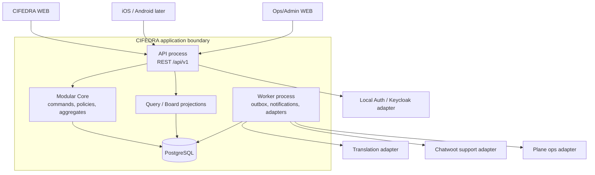
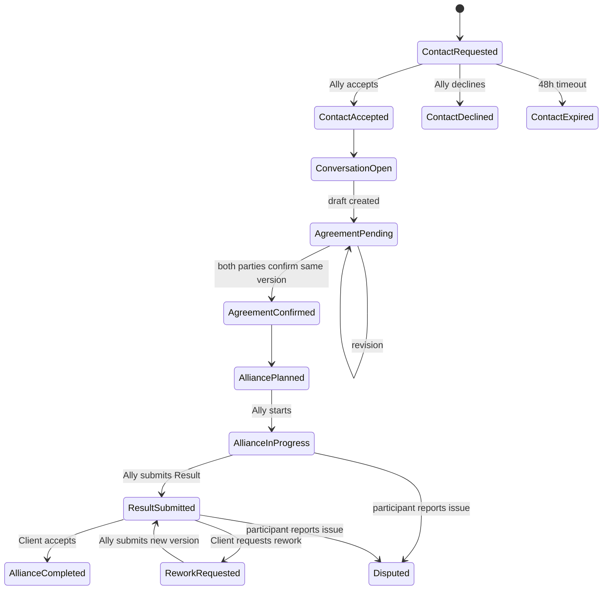

# CIFEDRA: MVP Architecture Delta

Дата: 2026-11-12
Версия: 0.1
Статус: authoritative delta до синхронизации HLD и ADR

## 1. Назначение

Документ устраняет расхождение между HLD июня 2026 года и утвержденной картой
клиентского приложения. В случае противоречия для локального клиентского MVP
применяется эта дельта.

Неизменными остаются решения:

- modular monolith + отдельный worker process;
- PostgreSQL как source of truth;
- REST/JSON `/api/v1`, OpenAPI 3.1 и `application/problem+json`;
- transactional outbox/inbox и at-least-once delivery;
- adapters для Keycloak, Chatwoot, Plane, translation и будущих PSP;
- единый lifecycle и Core для `Life`, `Work`, `Skills`.

Связанные документы:

- [HLD](./cifedra-hld.md);
- [ADR-001](../adr/ADR-001-architecture-style-and-docker-topology.md);
- [ADR-002](../adr/ADR-002-postgresql-core-data-platform.md);
- [ADR-003](../adr/ADR-003-interservice-communication-standard.md);
- [карта приложения](../product/cifedra-app-map-2026-07-26.md);
- [User Story Map](../product/cifedra-user-story-map-mvp-2026-11-12.md).

## 2. Исправляемое расхождение

Старый HLD использует сокращенную последовательность:

```text
ContactRequest accepted -> Engagement
```

Для клиентского MVP утверждена последовательность:

```text
ContactRequest accepted
  -> Conversation open
  -> Agreement draft/revisions
  -> Agreement mutually confirmed
  -> optional field-level Disclosure Consents
  -> Alliance planned
  -> Alliance in progress
  -> Result submitted/reviewed
  -> Alliance completed or disputed
```

Принятие ContactRequest не создает Alliance и не раскрывает прямые контакты.

## 3. Authoritative scope

| Capability | Local MVP | Source of truth | Внешняя система |
| --- | --- | --- | --- |
| Identity/session | Local adapter; OIDC boundary готова | CIFEDRA profile + trusted principal | Keycloak позже |
| Profile/roles | Да | CIFEDRA Core/PostgreSQL | Нет |
| Request intake/decomposition | Да | CIFEDRA Core/PostgreSQL | Нет |
| Matching/shortlist | Да | CIFEDRA Core/PostgreSQL | AI/provider только adapter |
| ContactRequest | Да | CIFEDRA Core/PostgreSQL | Уведомление через worker |
| Product messenger | Да | CIFEDRA Conversation/PostgreSQL | Chatwoot только support/ops projection |
| Agreement | Да | CIFEDRA Core/PostgreSQL | Нет |
| Disclosure consent | Да | CIFEDRA Trust/PostgreSQL | Нет |
| Alliance/work execution | Да | CIFEDRA Core/PostgreSQL | Plane только ops projection |
| Result/rework/dispute | Да | CIFEDRA Core/PostgreSQL | Object storage позже по D0 |
| Notifications | In-app обязательно | CIFEDRA notification intent/state | Push/email позже |
| Ops/Admin minimum | Да | CIFEDRA Core/audit | Baserow не является source of truth |
| Real payment | Нет | Mock contract only | PSP после legal/commercial gate |
| Voice/Whisper/video | Нет | Extension points | Deferred |

## 4. Контейнерная архитектура MVP



`API` и `Worker` — разные процессы одной application boundary. Доменные
модули не становятся сетевыми микросервисами до появления измеримого основания
из ADR-001.

## 5. Модули Core

| Модуль | Владеет | Не владеет |
| --- | --- | --- |
| Identity/Profile | Principal mapping, user profile, roles, locale, privacy settings | Credentials и IdP sessions |
| Catalog/Request | Catalog versions, Request Bundle, Ally Request, Intake, Clarification | Match score и provider profile |
| Matching | Match Run, Candidate, explanation, Candidate Decision | Contact acceptance и communication |
| Contact | ContactRequest lifecycle, expiry, safe brief snapshot | Conversation messages и direct contacts |
| Communication | Conversation, participant membership, Message, translation records | Agreement confirmation и Alliance status |
| Agreement | Versioned terms, party confirmations, revision lifecycle | Disclosure permission и execution progress |
| Trust/Disclosure | Field-level consent, revocation, visibility policy, report/block | IdP role assignment |
| Alliance | Planned/in-progress/blocked/cancelled/disputed lifecycle, timeline, Work Card | Result acceptance decision |
| Result | Result versions, evidence metadata, review, rework cycle | Payment settlement |
| Board/Notification | Read projections, next action, notification intent/state | Доменные переходы через drag-and-drop |
| Operations/Audit | Ops Case, reasoned admin command, immutable audit facts | Неаудируемая подмена решения пользователя |

`Life`, `Work`, `Skills` задают schema/policy configuration поверх этих модулей
и не получают отдельные сервисы или базы.

## 6. Aggregate boundaries и инварианты

### 6.1 Request Bundle

- содержит ссылки на один или несколько `AllyRequest`;
- split proposal не создает child requests до подтверждения клиента;
- каждый child request имеет независимый matching и Alliance;
- Bundle status вычисляется из child statuses и не перезаписывает их.

### 6.2 Ally Request

- владелец — один client profile;
- schema version и original answers неизменяемо идентифицируются;
- matching разрешен только после readiness и client review snapshot;
- изменение hard constraints после matching создает новую revision/match run.

### 6.3 ContactRequest

- создается для одного Request и одного выбранного Ally;
- хранит безопасный brief snapshot и policy version;
- `accepted` открывает Conversation, но не Alliance;
- `declined`, `expired`, `cancelled` не раскрывают закрытые поля;
- default response timeout — 48 часов.

### 6.4 Conversation

- создается только после `ContactRequest.accepted`;
- участники фиксируются сервером, а не request payload;
- сообщение хранит immutable original и optional translation records;
- телефон, email и точный адрес фильтруются/маскируются до разрешенного
  disclosure, но исходные закрытые данные не пересылаются внешнему adapter;
- Chatwoot может получить support projection, но не владеет conversation state.

### 6.5 Agreement

- каждая revision имеет монотонную версию и immutable snapshot terms;
- подтверждение относится только к одной версии;
- любое изменение terms отзывает confirmations предыдущей активной версии;
- `confirmed` достигается только после подтверждения клиента и Ally;
- AI может предложить draft, но не создает party confirmation.

### 6.6 Disclosure Consent

- согласие принадлежит субъекту раскрываемых данных;
- содержит purpose, field set, recipient, policy version и timestamps;
- согласие каждой стороны независимо;
- отзыв влияет на последующий доступ, но не переписывает audit history;
- Agreement может быть исполнен полностью внутри CIFEDRA без раскрытия прямых
  контактов.

### 6.7 Alliance

- создается в `planned` только для подтвержденного Agreement;
- start выполняет Ally при действующей Agreement version;
- scope revision не перезаписывает исторические события;
- Board status является проекцией, не изменяемым вручную полем;
- завершение возможно только через Result acceptance или явно определенный
  cancellation/dispute flow.

### 6.8 Result

- Result имеет версии; новая версия не заменяет предыдущую;
- submit фиксирует Agreement criteria snapshot;
- принять Result может только client owner;
- rework требует комментарий и возвращает Alliance в `rework_requested`;
- dispute создает Ops Case и сохраняет все версии/evidence metadata.

## 7. State transitions



Cancellation transitions существуют отдельно на допустимых стадиях и всегда
требуют actor, reason и policy check.

## 8. Write path и транзакции

Каждая command выполняется так:

```text
HTTP command
  -> authenticate trusted principal
  -> validate DTO and Idempotency-Key/expectedVersion
  -> authorize actor against resource and transition
  -> load one aggregate transaction boundary
  -> apply domain command
  -> save aggregate + audit fact + outbox events atomically
  -> return resource/version/nextAction
```

Между агрегатами не используется распределенная транзакция. Реакции выполняются
через outbox/application process manager. Например, `ContactAccepted` приводит
к idempotent `OpenConversation`; ошибка worker не откатывает acceptance и
показывается как retryable operational state.

## 9. API resource boundary

| Resource | Основные команды MVP |
| --- | --- |
| `/profiles` | create/update readiness, role context |
| `/request-bundles` | propose/confirm split, query group projection |
| `/requests` | draft/update/clarify/review/run matching |
| `/match-runs` | status/results/no-match options |
| `/candidate-decisions` | save/reject/request contact |
| `/contact-requests` | create/accept/decline/cancel |
| `/conversations`, `/messages` | list/open/send/query translations |
| `/agreements` | create revision/confirm/request revision |
| `/disclosure-consents` | grant/revoke/query visible fields |
| `/alliances` | start/update/block/cancel/report issue |
| `/results` | draft/submit/accept/request rework/dispute |
| `/boards` | read-only role-specific projection and next actions |
| `/notifications` | list/read/act |
| `/ops/cases` | list/query/resolve with permission and reason |

Command endpoint принимает `expectedVersion` или `If-Match`. Create и команды с
side effects принимают `Idempotency-Key`. Ошибки возвращаются как RFC 9457 с
stable `code`, `correlationId` и безопасными details.

## 10. Data ownership

| PostgreSQL schema | Aggregate/table groups |
| --- | --- |
| `identity`, `people` | Identity references, profiles, roles, preferences |
| `catalog`, `need` | Catalog version, Request Bundle, Ally Request, Clarification |
| `matching` | Match Run, Candidate, Candidate Decision |
| `engagement` | ContactRequest, Agreement, Alliance, Work Card, Result |
| `communication` | Conversation, participant, Message, Translation |
| `trust` | Disclosure Consent, report, block, verification |
| `integration` | outbox, inbox, external refs, retry state |
| `audit` | append-oriented audit facts and admin reasons |

Logical aggregate separation is mandatory even when several aggregates share a
physical schema. Foreign-key cascade across module ownership boundaries is not
used.

## 11. Board projection

Board is a query model derived from domain state:

```text
Domain aggregates/events
  -> projection updater
  -> role-specific board item
       resourceType
       resourceId
       displayStage
       title
       counterpartyPreview
       nextAction
       dueAt
       attentionReason
       projectionVersion
```

Drag-and-drop cannot execute a generic status update. UI opens the detail route
and invokes a specific allowed command.

## 12. AI and Ops trust boundary

AI/Ops assistant may:

- classify a request and recommend a schema;
- propose clarification and decomposition;
- rank/explain candidates subject to hard constraints;
- prepare Agreement draft and translation;
- detect timeout, anomaly or dispute and open an Ops suggestion.

AI/Ops assistant may not:

- accept/decline ContactRequest for a person;
- confirm Agreement or disclosure;
- start work or accept Result for a participant;
- weaken hard constraints without client confirmation;
- read closed fields without an authorized purpose.

Каждый AI-produced artifact хранит provider/model or ruleset version,
timestamp, input references, confidence/provenance и human decision. При
недоступности AI deterministic intake, manual selection и communication
остаются работоспособными.

## 13. Security boundary

Минимальные правила MVP:

1. Self-registration создает только client capability.
2. Ally activation требует отдельного profile readiness rule; operator/admin
   role не назначается из public payload.
3. Actor и owner IDs извлекаются из trusted principal/server state.
4. Exact address, direct contacts и artifacts закрыты по field policy.
5. Все list/query endpoints фильтруют ownership/participation до pagination.
6. Admin override требует permission, reason и audit event.
7. Logs/events не содержат message body, contacts, exact address или artifact
   content.
8. Synthetic local profile привязан к loopback и не разрешает real data.

## 14. Локальная deployment topology

Ежедневный профиль:

```text
cifedra-web
cifedra-api
cifedra-worker
cifedra-postgres
```

Опциональные профили:

- `identity`: Keycloak + отдельная DB;
- `support`: Chatwoot stack;
- `tasks`: Plane stack;
- `language`: local translation candidate;
- `observability`: logs/metrics/traces.

Vendor stacks не обязательны для прохождения product E2E и не подключаются к
таблицам Core.

## 15. Обязательные синхронизации

До OpenAPI freeze нужно:

1. оформить ADR по post-contact lifecycle и aggregate boundaries;
2. оформить ADR по product messenger/source of truth;
3. оформить ADR по AI/Ops trust boundary;
4. обновить HLD sections 6, 12.3, 13.1, 14.2-14.3 и 16.2;
5. обновить target architecture `Build / Integrate / Defer`;
6. создать Use Cases из User Story Map;
7. создать SRS Agreement/Messenger/Alliance/Result;
8. расширить OpenAPI и state transition catalog;
9. построить traceability `CJM -> USM -> Screen -> UC -> FR -> API -> Test`.

## 16. Acceptance criteria дельты

1. Ни один новый документ или endpoint не создает Alliance непосредственно из
   ContactRequest acceptance.
2. Product chat и Agreement входят в локальный MVP.
3. Chatwoot, Plane и Baserow остаются replaceable adapters/projections.
4. Доменные transitions нельзя выполнить generic status update.
5. Board является role-specific read model с одним next action.
6. Human confirmation обязательна для Agreement, disclosure и Result.
7. Архитектура сохраняет modular monolith и одну Core PostgreSQL boundary.
8. WEB является первым клиентом API; iOS/Android используют те же contracts.
